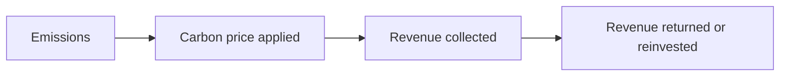

This is a sample article. It shows each feature the site supports, so you can copy the pieces you need and then delete this page.

## Linking to terms

Write a term in double square brackets to link to its definition, like [[Carbon price]] or [[Externality]]. Hover over a link to preview the definition.

To show different text, use a pipe: [[Externality|external costs]].

Each term page automatically lists the articles that link to it, under "Backlinks".

## Figures

Put image files in the `figures` folder and embed them like this:

![[example-figure.svg]]

## Diagrams

Mermaid diagrams are written as text and drawn on the page:

## Spreadsheets readers can copy

Use the snippet in `templates/Article.md`. It embeds a live view of a Google Sheet and adds a "Make a copy" link, so readers can save their own editable version.

> [!tip] Setting up a sheet
> 1. In Google Sheets, choose **Share → General access → Anyone with the link → Viewer**.
> 2. Choose **File → Share → Publish to web → Embed**, and copy the `src` address from the code it shows.
> 3. Copy the sheet's ID from its normal address: the long string between `/d/` and `/edit`.
